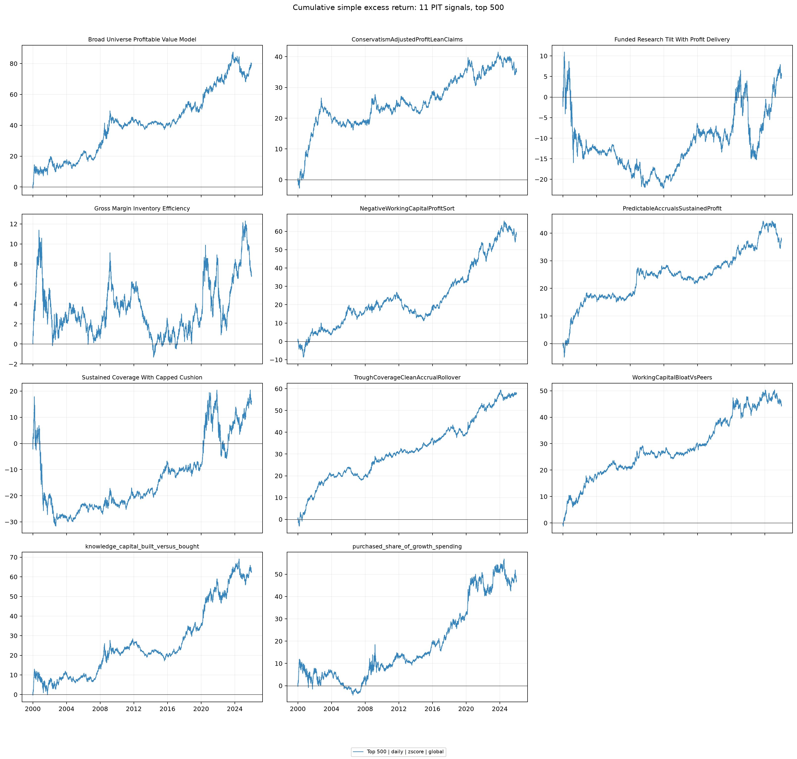
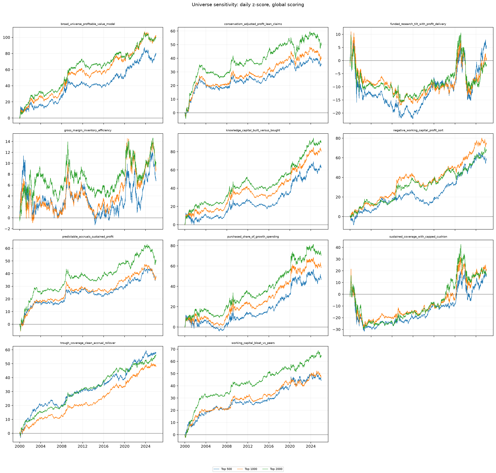

# Fundamental Interaction

A daily, point-in-time research workflow for studying how the eleven published
fundamental signals in *Can AI Do Financial Research? LLM-Guided Hypothesis
Discovery in Asset Pricing* interact in large-cap U.S. equities. The baseline
universe is the dynamically reconstituted CRSP Top-500 by lagged market
capitalization, with Top-1,000 and Top-2,000 sensitivity runs. It uses local
CRSP daily returns, Compustat North America Annual, and time-valid CCM link
history through `us_equities_datahandler`.

> **Data availability.** The repository contains code, notebooks, tests, and
> presentation figures only. CRSP, Compustat, and CCM are licensed WRDS/vendor
> datasets and are deliberately excluded. Point the data-handler configuration
> at a locally licensed copy before running the pipeline.

The active implementation is `us_equities_signal_research`.

## What it does

- Reconstructs each firm's Annual accounting history only from records whose
  `available_date` has arrived (`fdate`, otherwise `datadate + 6 months`).
- Applies time-valid CCM links and produces a cached daily `date × permno` raw
  panel for every signal.
- Implements the eleven paper formulas independently, including formula-level
  `RANK`, `WINSOR`, `SUMRANK`, and two-digit-Compustat-SIC industry operators.
- Forms equal-risk long–short portfolios with global 1% winsorization,
  `zscore`, `rank`, or `quintile` weights; optional SIC-division scoring; and
  daily, weekly, or monthly rebalancing.  Raw panels and fully scored daily
  weights are cached separately in the visible shared DataHandler cache.
- Uses the strict timing convention: a signal observed after close on `t`
  forms at `t+1` close and earns the `t+1 → t+2` close-to-close return.

The standard run evaluates three dynamically reconstituted CRSP universes by
lagged market capitalization: top 500, top 1,000, and top 2,000, from 2000
through 2025. Daily stock returns
are made excess by subtracting the equal-weight return of securities with a
non-null raw signal on that date.

## Completed daily portfolio grid

The checked-in figures use daily rebalancing, global scoring, and z-score
weights. The first figure is the top-500 baseline; the second overlays the
three dynamic market-cap universes for each of the eleven signals.





## Run

```bash
docker compose build
docker compose run --rm research python -m us_equities_signal_research.cli --rank-ltes 500,1000,2000
```

The persistent cache is a normal, visible directory under the shared data layer:

```text
US_Equities_DataHandler/data/cache/
  crsp/                         # generic CRSP date × permno panels
  signal-laboratory/
    raw/                        # 11 PIT raw signal panels, versioned
    scores/                     # cached zscore/rank/quintile weight panels
```

The research container bind-mounts this directory at `/cache`; it does not use a Docker named volume for research data.

Open Jupyter Lab with `docker compose up -d`, then use
[`notebooks/01_pit_backtest_report.ipynb`](notebooks/01_pit_backtest_report.ipynb)
to run or inspect the complete grid. The grid parameters are ordinary Python
lists, so the report can overlay any Cartesian product of frequency, weight
method, and SIC treatment for all eleven signals.

## Repository layout

```text
src/us_equities_signal_research/  PIT signal recipes, scoring, and backtests
notebooks/                        reproducible research report
tests/                            timing, formula, and portfolio tests
assets/                           committed figures shown above
```

Generated data, result caches, notebook checkpoints, and local configuration
are excluded by `.gitignore`. This keeps the repository portable while the
large licensed inputs and derived panels remain local.
