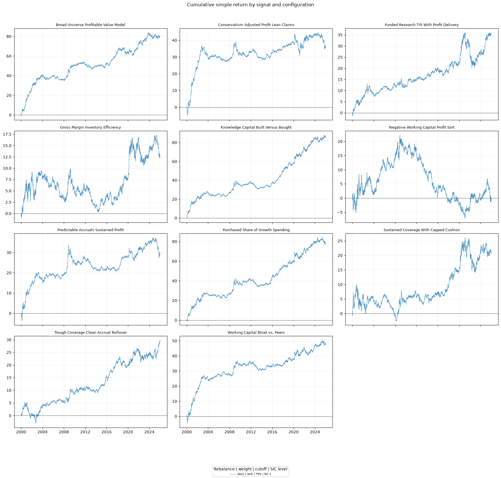
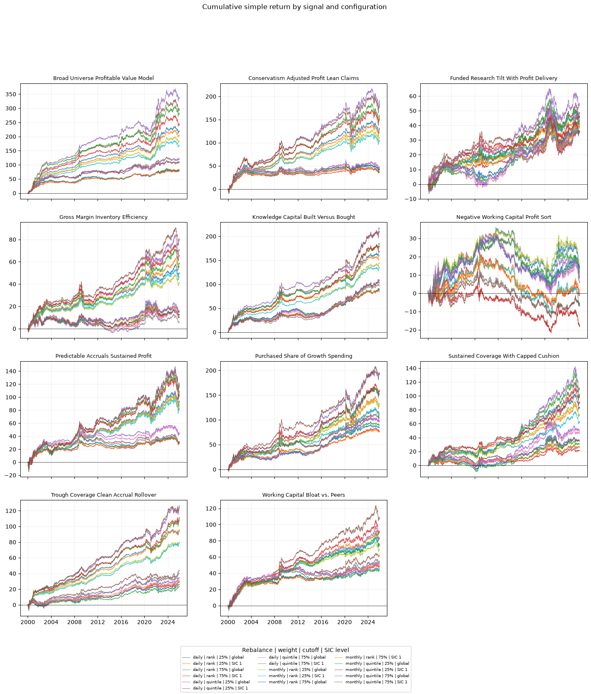

# US Equities Alpha Research

A Docker-based research pipeline for evaluating eleven accounting-driven US equity signals with daily CRSP–Compustat data from 2000 through 2025. It turns point-in-time annual fundamentals into daily cross-sectional signals, forms long–short portfolios, and reports return, risk, turnover, drawdown, and Newey–West t-statistics.

## Results

The first chart uses daily rebalancing, rank weights, a 75% microcap cutoff, and SIC-division scoring. The second shows the stored sensitivity grid across rebalance frequencies, weight methods, microcap cutoffs, and SIC settings.





## Research design

- **Universe:** CRSP common stocks linked to Compustat through CCM; financial firms (SIC 6000–6999) are excluded.
- **Availability:** Compustat data become usable on `fdate`; missing `fdate` falls back to `datadate + 6 months`.
- **Signals:** Each daily cross-section is winsorized at 1%/99%, then transformed into `zscore`, `rank`, or `quintile` weights.
- **Portfolio:** Global net exposure is zero and gross exposure is one. The microcap cutoff grid is 25%, 50%, and 75% of the daily lagged-market-cap distribution.
- **Timing:** A signal observed at close *t* is executed at close *t+1* and earns the next close-to-close return.
- **Evaluation:** Daily, weekly, and monthly rebalancing; annualized return and volatility, Sharpe ratio, average daily bets, two-way turnover, maximum drawdown, and Newey–West t-statistics.

## Run locally

Licensed CRSP, Compustat Annual, and CCM input files are required and deliberately excluded from the repository. Point `RAW_DATA_ROOT` in `.env` at their local directory, then start the contained environment:

```bash
cp .env.example .env
# Set RAW_DATA_ROOT and an unused JUPYTER_PORT in .env.
docker compose up --build
```

Open the tokenized localhost URL printed by Jupyter Lab. The primary report is [notebooks/01_signal_backtest_report.ipynb](notebooks/01_signal_backtest_report.ipynb).

The pipeline is modular: `audit`, `signals`, `universe`, `daily-signals`, `materialize-panels`, `materialize-sic`, `materialize-wide-base`, `materialize-wide-signals`, `cache-weights`, and `wide-grid`.

## Repository layout

```text
src/daily_signal_backtest/   pipeline and portfolio engine
notebooks/                   interactive report
configs/                     research settings
assets/                      exported public figures
```

This repository contains code, configuration, notebooks, and rendered research figures only. It does not distribute licensed data or derived security-level panels.
